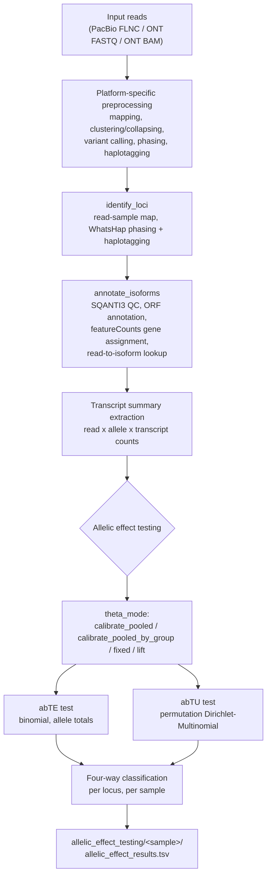

<p align="center">
  
</p>

# LASER: Long-read Allele-Specific Expression Resolver

LASER is a Nextflow pipeline for long-read RNA-seq analysis, designed to identify allele-specific expression (ASE) and transcript usage from PacBio Iso-Seq and Oxford Nanopore Technology (ONT) data.

## Pipeline overview




## Library, sample and locus eligibility

### Library
LASER supports the following input types:

**PacBio (Iso-Seq)**
- Any PacBio machine (Sequel IIe, Revio)
- Single-sample or multiplexed libraries
- MAS-Iso-Seq or classic Iso-Seq
- Targeted or transcriptome-wide

**ONT (Oxford Nanopore)**
- Direct RNA sequencing (`ont_directrna` platform)
- cDNA sequencing (`ont_cdna` platform) - from FASTQ, includes pychopper adapter trimming
- cDNA sequencing (`ont_cdna_minimap_entry` platform) - from unmapped BAMs, skips pychopper
- One FASTQ file per sample (named `SAMPLE.fastq.gz`) for `ont_cdna` and `ont_directrna`; one unmapped BAM per sample for `ont_cdna_minimap_entry`

### Sample
LASER is designed for diploid organisms and has been tested on human and mouse tissue and iPSC samples.

### Loci
For a locus to be eligible it must be diploid: targets on the Y chromosome and mitochondrial genome are excluded. Loci must contain informative positions (heterozygous, expressed SNVs that differ between the two alleles, typically exonic or in UTRs). LASER identifies these automatically.

Assessment of allelic bias in total expression (abTE) and allelic bias in transcript usage (abTU) is performed by the allelic effect testing stage (see below), and requires total expression above a configurable threshold (default: 30 reads, `min_total_reads_per_locus`), a minimum number of phased reads (default: 30, `min_phased_reads_per_locus`), and a bound on the unphased proportion (default: 30%, `max_unphased_prop`). Assessment of abTU additionally requires more than one detected transcript at the locus (default: 2, `min_transcripts_per_locus`).


## Prerequisites

- **Linux** (tested on HPC cluster nodes; not tested on macOS/Windows).
- **conda or mamba, via [Miniforge](https://github.com/conda-forge/miniforge)**. This is the recommended way to get both. Installing conda on its own (e.g. via Anaconda/Miniconda without mamba) will work but environment solves will be noticeably slower; LASER's setup scripts use `mamba` for this reason. If you already have Miniconda, install mamba into it (`conda install -n base -c conda-forge mamba`) rather than starting over.
- **git, wget and a system python3** - used by `setup_tools.sh` to fetch and unpack SQANTI3/ORFannotate.
- `setup_envs.sh` will install `jq` and `curl` into your conda **base** environment if they aren't already on PATH (a SQANTI3 post-link script needs them).
- **Singularity or Apptainer** (used for DeepVariant/Clair3-RNA containers). Check with `singularity --version` or `apptainer --version` / `module load singularity` on HPC systems. Ask your HPC administrator if neither is available.
- **Sufficient compute for setup, not just for runs** - see the callout below before running the setup scripts (Steps 2 & 3 below).

> **Do not run `setup_tools.sh` / `setup_envs.sh` on an HPC login node.** These scripts do real work (cloning/downloading tools, solving and building multiple conda environments) and commonly exceed login-node limits. Many HPC systems cap login nodes at a handful of CPUs and a small amount of memory per user, and setup will simply be killed partway through. Submit setup as a batch job or run it on an interactive compute node instead. A generic SLURM example (adjust partition/account/time/resources to your cluster):
> ```bash
> sbatch --job-name=laser_setup \
>        --cpus-per-task=4 \
>        --mem=32G \
>        --time=02:00:00 \
>        --wrap="bash scripts/setup/setup_tools.sh && bash scripts/setup/setup_envs.sh"
> ```

## Quickstart

### 1. Clone the repository
```bash
git clone https://github.com/MacphersonHannah/LASER-1.1.git
cd LASER-1.1
```

### 2. Install required tools
Run this from the LASER-1.1 root directory (the one containing `main.nf`); both setup scripts use paths relative to it.

```bash
bash scripts/setup/setup_tools.sh
```
This checks for Singularity, downloads ORFannotate, SQANTI3, and DeepVariant, and creates a DeepVariant sandbox. Speak to your HPC administrator if Singularity is not available.

### 3. Create required environments
Again from the LASER-1.1 root directory.

```bash
bash scripts/setup/setup_envs.sh
```
Creates all conda environments under `envs_prebuilt/`. Existing environments are skipped.

| env | covers |
|---|---|
| `pacbio_prep_env` | mapping, refinement (FLNC), demultiplexing (pbmm2, minimap2, isoseq, lima) |
| `core_utils_env` | orchestration + phasing/VCF utilities (nextflow, whatshap, bcftools). For manual use: `conda activate envs_prebuilt/core_utils_env` |
| `isoform_collapse_env` | isoform collapse + basecall trimming (cdna_cupcake, pychopper) |
| `stats_r_env` | allelic effect testing statistics (R) |
| `flair_env` | tool-specific, kept separate due to incompatible dependency pins |
| `SQANTI3`, `ORFannotate` | tool-specific, installed by `setup_tools.sh` |

### 4. Configure your run
Copy the example config that matches your platform from example_configs/ and edit the paths to match your data and references. See Configuration below and the comments inside each example for guidance.

```bash
cp example_configs/example_ont_cdna_minimap_entry.config my_run.config
# edit my_run.config with your paths, then pass it to run_LASER.sh (step 5)
```
See example_configs/ : the table under Configuration lists which file matches each platform

### 5. Run LASER
```bash
bash run_LASER.sh {RUN_NAME} {config_file}
```
This activates the required environment (core_utils_env) automatically.

Working files are written to `run_{RUN_NAME}/work_{RUN_NAME}/`. Results are written to `run_{RUN_NAME}/{RUN_NAME}/`. The config file used is automatically copied into the results directory for reproducibility, along with the Nextflow run report, timeline and trace.

Results are hard-linked to the work directory rather than copied, so they cost almost no extra disk and survive deletion of the work directory.

`RUN_NAME` decides where output goes: `run_LASER.sh` always passes `--outdir` on the Nextflow command line. Edit `RUN_NAME` when starting a new run. To re-run a run, just call it the same RUN_NAME and the --resume flag in run_laser.sh will resume from whatever has changed. To bypass this, delete --resume in run_laser.sh or delete the folder of the original run output.

Run this on a compute node (or submit as a job), not a login node. See the resource callout under Prerequisites; the same login-node limits that affect setup apply to the actual pipeline run, which is far more resource-hungry.

### 6. (Optional) Run on test data first

Each platform has a small test dataset bundled under `test_data/`, with a ready-to-use config file. These are subsampled to 50,000 reads (10,000 for `pacbio`) per sample and should complete in under 30 minutes on a node with 16+ cores and 120 GB RAM. Running a test first is a good way to check that setup completed correctly and your cluster environment works before committing to a full-sized run.

```bash
# Example: test the ont_cdna_minimap_entry platform
bash run_LASER.sh test_minimap_entry test_data/ONT_cDNA_minimap_input/ONT_cDNA_test_data_minimap_input.config
```

| Platform | Test data directory | Test config | Samples |
|---|---|---|---|
| `pacbio` | `test_data/PACBIO_untargeted_not_fastq_entry/` | included config | 2 samples, 10k reads each |
| `pacbio_fastqentry` | `test_data/PACBIO_untargeted_fastq_entry/` | included config | 2 ENCODE samples, 50k reads each |
| `ont_cdna` | `test_data/ONT_cDNA/` | included config | 2 control brain samples, 50k reads each |
| `ont_cdna_minimap_entry` | `test_data/ONT_cDNA_minimap_input/` | included config | 2 samples, 50k reads each |
| `ont_directrna` | `test_data/ONT_directRNA/` | included config | 3 ENCODE samples, 50k reads each |

You will need to update the reference file paths in the test config to match your local installation before running. The test configs use placeholder paths.


## Platform selection

Set `params.platform` in your config to one of:

| Platform | Description | Isoform discovery | Variant calling | Test data |
|---|---|---|---|---|
| `pacbio` | PacBio Iso-Seq from raw demultiplexed BAMs. Runs the full IsoSeq3 pipeline: refine, cluster2, collapse, and abundance. Standard or MAS-Iso-Seq (run Skera first for MAS). | isoseq3 cluster2 + collapse | DeepVariant (default) or Clair3-RNA | `test_data/PACBIO_untargeted_not_fastq_entry/` |
| `pacbio_fastqentry` | PacBio Iso-Seq from already-refined FLNC reads (BAM or fastq.gz). Enters at cluster2, skipping demux and refine. Use this for data downloaded from repositories, processed on another system, or MAS-Iso-Seq that has already been through Skera + lima + isoseq refine. | isoseq3 cluster2 + collapse | DeepVariant (default) or Clair3-RNA | `test_data/PACBIO_untargeted_fastq_entry/` |
| `ont_cdna` | ONT cDNA sequencing from FASTQ. Includes pychopper for adapter trimming before alignment. Full-length reads go to FLAIR for isoform discovery; if `pychopper_rescued = true`, full-length plus rescued reads are used for everything else (variant calling, phasing and quantification). Set `params.ont_chemistry` to `r9` or `r10` to select the correct minimap2 preset. | FLAIR | Clair3-RNA | `test_data/ONT_cDNA/` |
| `ont_cdna_minimap_entry` | ONT cDNA sequencing from unmapped BAMs which have already been processed with Pychopper. Skips pychopper entirely; all reads go through a single FLAIR stream for both isoform discovery and quantification. Use this when your data has not been through pychopper, or when you want to skip adapter trimming. | FLAIR | Clair3-RNA | `test_data/ONT_cDNA_minimap_input/` |
| `ont_directrna` | ONT direct RNA sequencing. No adapter trimming (pychopper is not used). Reads go straight to minimap2 alignment and FLAIR for isoform discovery. | FLAIR | Clair3-RNA | `test_data/ONT_directRNA/` |


## Configuration

### Platform selection
```groovy
params.platform = 'pacbio'   // see table above
```

### PacBio inputs

#### Option A: Starting from demultiplexed BAMs (`pacbio`)

**LASER never runs `lima`/demultiplexing itself; this is always a step you run yourself before pointing LASER at your data.** Your PacBio BAMs must already be demultiplexed into one BAM per sample by the time you configure a run. The required steps depend on your library type:

| Library type | Steps before LASER |
|---|---|
| Standard Iso-Seq | Run `demux_pacbio.sh` |
| MAS-Iso-Seq | Run Skera first, then run `demux_pacbio.sh` on the output |

**Standard Iso-Seq:**
```bash
bash scripts/setup/demux_pacbio.sh input.bam primers.fa output_dir
```

**MAS-Iso-Seq** - first run Skera to segment the concatenated reads, then demultiplex:
```bash
# Step 1: Skera (must be run separately, not bundled with LASER)
skera split input.bam mas_primers.fasta skera_output.bam

# Step 2: Demultiplex with Lima
bash scripts/setup/demux_pacbio.sh skera_output.bam primers.fa output_dir
```

| Argument | Description |
|---|---|
| `input.bam` | Raw CCS BAM from the PacBio sequencer (or Skera output for MAS-Iso-Seq) |
| `primers.fa` | FASTA file containing your 5' and 3' barcode sequences |
| `output_dir` | Directory to write demultiplexed BAMs (created if it doesn't exist) |

The primer FASTA is automatically copied into `output_dir` alongside the BAMs, as LASER requires them to be in the same directory.

Once complete, point LASER at the output directory in your config:

```groovy
params.library_dirs     = ['/path/to/output_dir']
```

For multiple libraries, provide one output directory per library. Each must contain its own BAMs and primer file. LASER iterates over every entry in `library_dirs` automatically, so no extra flag is needed:

```groovy
params.library_dirs = ['/path/to/lib1_output', '/path/to/lib2_output']
```

Bear in mind that every library run in parallel will increase your runtime and required compute. LASER has been tested successfully on 40 ENCODE PacBio RSII samples at once, but the ceiling will depend on your cluster and read depth. 

#### Option B: Starting from refined FLNC reads (`pacbio_fastqentry`)

Use this platform if your reads have already been through `isoseq3 refine` upstream of LASER, for example data downloaded from a repository or processed on a different system.

Point `params.library_dirs` at a directory containing one FLNC file per sample. Accepted formats: `.bam`, `.fastq.gz`, `.fq.gz`, `.fastq`, `.fq`. The sample name is taken from the filename (extension and any trailing `_flnc`/`.flnc` stripped):

```
/path/to/flnc_data/
    sample1_flnc.bam         -> sample name: sample1
    sample2.flnc.fastq.gz    -> sample name: sample2
```

```groovy
params.platform      = 'pacbio_fastqentry'
params.library_dirs  = ['/path/to/flnc_data']
```

If your FLNC files are fastq/fq.gz rather than BAM, `params.pacbio_template_bam` must point to a valid PacBio BAM header template (one is provided in `test_data/`):

```groovy
params.pacbio_template_bam = "${projectDir}/test_data/pacbio_header_template.bam"
```

**Leave this pointing at the bundled template; do not swap it for your own BAM.** Converting fastq back to BAM needs a valid PacBio-style header (the `@RG`/`@PG` fields, movie/well identifiers, and other PacBio-specific metadata that `pbmm2`/`isoseq3` expect), or downstream steps error out. The bundled template supplies exactly that header without carrying any of your actual read data or sample-specific information.

The underlying conversion approach is based on [`Convert2PacBioBAM`](https://github.com/jmestret/Convert2PacBioBAM) by Jorge Mestre Tomas, an unofficial tool for converting FASTA/FASTQ reads to a PacBio-format BAM using a real PacBio BAM as a header template.

#### PacBio processing steps

The `pacbio` platform runs the following steps (the `pacbio_fastqentry` platform enters at cluster2, skipping the first two):

```
[demux_pacbio.sh - run separately]
  |
Refine (primer removal + poly-A trimming)       <- pacbio only
  |
isoseq3 cluster2 (per sample and bulk)          <- pacbio_fastqentry enters here
  |
pbmm2 align (ISOSEQ preset)
  |
isoseq3 collapse (isoform collapse)
  |
get_abundance (FL count per isoform)
  |
SQANTI3 QC + ORFannotate
  |
DeepVariant variant calling (or Clair3-RNA if configured)
  |
WhatsHap phasing + haplotagging
  |
Transcript summary extraction (read x allele x transcript counts)
  |
Allelic effect testing (abTE / abTU)
```

### ONT inputs

#### Option A: Starting from FASTQ (`ont_cdna`, `ont_directrna`)

LASER expects one concatenated FASTQ per sample named `SAMPLE.fastq.gz`, where the filename becomes the sample name throughout all outputs, so name files clearly (e.g. `patient1_thalamus.fastq.gz`).

Most basecallers produce multiple FASTQ files per sample (e.g. one per batch in `fastq_pass/`). Concatenate them using the provided helper script:

```bash
bash scripts/setup/concat_ONT_fastq.sh fastq_pass/ merged_fastq/ patient1_thalamus
```

| Argument | Description |
|---|---|
| `fastq_pass/` | Directory containing your raw FASTQ files |
| `merged_fastq/` | Output directory (created if it doesn't exist) |
| `patient1_thalamus` | Sample name; output will be `merged_fastq/patient1_thalamus.fastq.gz` |

Run once per sample. Once all samples are concatenated:

```groovy
params.ont_input_files = [
    '/path/to/patient1_thalamus.fastq.gz',
    '/path/to/patient2_thalamus.fastq.gz'
]
```

#### Option B: Starting from unmapped BAMs (`ont_cdna_minimap_entry`)

Use this platform when your data is in unmapped BAM format and you want to skip pychopper entirely as it has already been run. Each BAM becomes one sample; the filename (minus `.bam`) becomes the sample label.

```groovy
params.platform = 'ont_cdna_minimap_entry'
params.ont_input_files = [
    '/path/to/sample1.bam',
    '/path/to/sample2.bam'
]
```

All reads go through a single FLAIR stream for both isoform discovery and quantification/variant calling. No FASTQ concatenation is needed.

#### `ont_cdna` only: pychopper settings

The `ont_directrna` and `ont_cdna_minimap_entry` platforms skip pychopper entirely. For `ont_cdna`, set the appropriate kit matching your library preparation:

```groovy
params.pychopper_kit     = 'PCS114'   // R10.4.1 PCR cDNA barcoding
                                       // 'PCB114' for PCR cDNA barcoding 24-plex
                                       // 'PCS111' for older R9 PCR cDNA
params.pychopper_rescued = false       // set true to include pychopper-rescued reads
```

### References
```groovy
params.genome      = '/path/to/GRCh38_noY_noMT.fa'
params.gencode_gtf = '/path/to/gencode.v47_noY_noMT.annotation.gtf'
params.cage        = '/path/to/refTSS_v3.3_human_coordinate.hg38.bed'
params.intropolis  = '/path/to/intropolis.v1.hg19_with_liftover_to_hg38.min_count_10.tsv'
params.polya_atlas = '/path/to/atlas.clusters.2.0.GRCh38.96.mod.bed'
params.poly_motifs = '${projectDir}/assets/human.polyA.list.txt'
```

`params.genome` must be the **primary assembly** FASTA (chromosomes + unplaced/unlocalised scaffolds, not alternate allele contigs). This is what GENCODE/Ensembl label `*.primary_assembly.fa`, and is what pbmm2/minimap2 and downstream variant calling expect.

Where to get these, and realistic filenames you'll end up with:

| File | Where to get it | Typical filename |
|---|---|---|
| Genome FASTA (primary assembly) | [GENCODE downloads](https://www.gencodegenes.org/human/) | `GRCh38.primary_assembly.genome.fa` (or `GRCh38_noY_noMT.fa` if stripped, see below) |
| GTF annotation | [GENCODE downloads](https://www.gencodegenes.org/human/), matching release | `gencode.v47_noY_noMT.annotation.gtf` |
| `cage` (refTSS) | [refTSS database](http://reftss.clst.riken.jp/reftss/Main_Page) | `refTSS_v3.3_human_coordinate.hg38.bed` |
| `intropolis` | [Intropolis](https://github.com/nellore/intropolis) | `intropolis.v1.hg19_with_liftover_to_hg38.min_count_10.tsv` |
| `polya_atlas` | [PolyA_DB / PolyASite atlas](https://polyasite.unibas.ch/) | `atlas.clusters.2.0.GRCh38.96.mod.bed` |
| `poly_motifs` | **bundled with LASER** at `assets/human.polyA.list.txt`; also available in SQANTI3 at `data/polyA_motifs/human.polyA.list.txt` | `human.polyA.list.txt` |

Filtering Y and MT chromosomes out of the genome/GTF is optional but speeds things up. See `strip_sex_mito_chroms.sh` below.

```bash
bash scripts/setup/strip_sex_mito_chroms.sh /path/to/genome.fa /path/to/annotation.gtf /path/to/output_prefix
```

This strips `chrY`/`Y` and `chrM`/`MT` from both files, and runs `samtools faidx` on the resulting FASTA automatically. If you're using a reference you didn't strip with this script, run `samtools faidx` on it yourself before starting a LASER run, as several downstream steps assume a valid `.fai` index already exists alongside the FASTA.

### Species

LASER is species-agnostic at the pipeline level but requires the correct [CPAT](https://cpat.readthedocs.io/en/latest/) model, so in practice LASER can only be run on species CPAT supports. One param controls this for both ORFannotate and SQANTI3's species-specific behaviour:

```groovy
params.species = 'human'   // default; or 'mouse' for mouse data
```

Supported values correspond to the species available in CPAT. See the [CPAT documentation](https://cpat.readthedocs.io/en/latest/) for the full list. Only human and mouse data have been tested. Also see [Notes on non-human data](#notes-on-non-human-data) below.

### Variant calling

#### PacBio
DeepVariant is used by default and is strongly recommended for PacBio targeted runs. Clair3-RNA is available as an alternative.

```groovy
params.variant_caller = 'deepvariant'   // default; or 'clair3' to override
params.dv_container   = "${projectDir}/containers/deepvariant_1.9.0_sandbox"
params.dv_model       = 'MASSEQ'        // for Iso-Seq / MAS-Seq
params.clair3_model   = null            // only needed if variant_caller = 'clair3'
                                        // e.g. 'hifi_sequel2_pbmm2'
```

#### ONT
Clair3-RNA is used for all ONT platforms. Select the model matching your chemistry and basecaller:

```groovy
params.clair3_rna_model = 'ont_r10_dorado_cdna'    // R10.4.1 cDNA with Dorado
                        // 'ont_dorado_drna004'      // direct RNA R10 with Dorado
                        // 'ont_r9_guppy_cdna'       // R9.4.1 cDNA with Guppy
                        // 'ont_guppy_drna002'        // direct RNA R9 with Guppy
```

To list all available models:
```bash
singularity exec containers/clair3_rna_latest.sif ls /opt/conda/envs/clair3_rna/bin/clair3_rna_models/"
```

Clair3 Phasing

```groovy
params.clair3_enable_phasing = false   // default
```

Leave this `false`. It controls Clair3-RNA's `--enable_phasing_model`, which phases during variant calling. LASER phases separately with WhatsHap after calling, so enabling it duplicates the work.

Minimum coverage

```groovy
params.clair3_min_coverage = 2   // default
```

Minimum read depth for Clair3-RNA to attempt a call. This sets how many heterozygous sites are available as phase anchors, so it propagates into how many reads WhatsHap can haplotag and therefore how many loci pass `min_phased_reads_per_locus`. RNA coverage is
very uneven across genes, so a low value is deliberate here; the locus-level read filters remove thinly-covered loci afterwards. Raise it if you suspect false heterozygous calls are mis-assigning reads between haplotypes. 


### WhatsHap phasing options
```groovy
params.phase_indels   = true    // include indels in phasing (recommended)
params.phase_min_qual = 0       // recommended: keep at 0. Raising this can filter
                                 // variants unevenly between alleles, biasing ASE calls
params.hp_regions     = null    // optional BED file to restrict haplotagging region
```

### Resources
```groovy
process {
  cpus   = 16
  memory = '120 GB'
  time   = '100h'

  withName: 'RUN_DEEPVARIANT' {
    maxForks  = 7
    cpus      = 32
  }
  withName: 'RUN_CLAIR3_RNA' {
    container = "${projectDir}/containers/clair3_rna_latest.sif"
    maxForks  = 4
    cpus      = 16
    memory    = '32 GB'
  }

  // Allelic effect testing processes are single-threaded R
  withName: 'PREPARE_LOCI_TABLES|VALIDATE_THETA_SAMPLE_COUNT|VALIDATE_THETA_GROUP_SAMPLE_COUNT|CALIBRATE_THETA_POOLED|CALIBRATE_THETA_POOLED_BY_GROUP|RESOLVE_FIXED_THETA|LIFT_THETA|RUN_ALLELIC_EFFECT_TEST|MERGE_RUN_MANIFEST' {
    cpus   = 1
    memory = '8 GB'
    time   = '12h'
  }
}

executor {
  name      = 'local'
  cpus      = 250
  memory    = '900 GB'
  queueSize = 200
}
```


## Allelic effect testing

After transcript summary extraction, LASER runs two statistical tests per locus, per sample, on the read x allele x transcript count table:

- **abTE** (allelic bias in total expression): binomial test on allele-1 vs allele-2 total read counts.
- **abTU** (allelic bias in transcript usage): permutation Dirichlet-Multinomial test on the per-transcript allele count distribution. Detects a shift in transcript repertoire between alleles, even when total expression is balanced.

Each locus in each sample is classified into one of four categories: no detectable allelic effect, abTE only, abTU without detectable abTE, or both. Loci that don't pass the eligibility thresholds (see [Loci](#loci) above) are kept in the output with a `tested_status` explaining why, rather than silently dropped.

### The theta parameter, and which mode to use

abTU's Dirichlet-Multinomial test needs an overdispersion parameter, `theta`, reflecting how noisy transcript-usage counts are beyond simple multinomial sampling. `params.theta_mode` controls how it's set:

| mode | when to use it |
|------|-----------------|
| **`calibrate_pooled`** (default) | You have **at least 3 samples** (2 works but is not ideal, see below) and want a theta tailored to your own data's actual noise characteristics. Runs a permutation-based FPR calibration pooled across every sample in the run, once, and applies the result to every sample. |
| **`calibrate_pooled_by_group`** | You have **distinct sample groups** (e.g. tissues) and want a *separate* theta calibrated for each, rather than one theta pooled across the whole run or reusing an old value. Runs the exact same calibration as `calibrate_pooled`, once per group, using only that group's own samples. Requires `theta_group_table`; see [Defining groups](#defining-groups-for-calibrate_pooled_by_group) below. |
| **`fixed`** | You already know the right theta, from your own prior calibration, for a single-sample run where pooling isn't possible, or you just want to test a specific value. Supply `theta_fixed` (one value for every sample) or `theta_table` (CSV: `sample,theta` for per-sample values). |
| **`lift`** | You want to reuse an already-calibrated reference value instead of recalibrating, e.g. a single-sample run, a quick pilot, or matching the noise model of a companion dataset. Looks up a value from `assets/calibrated_thetas_reference.csv` by tissue/dataset name (`theta_lift_source`, default `all_encode`), with optional per-sample override via `theta_lift_table` (CSV: `sample,source`) if different samples in one run should lift from different sources (e.g. brain samples from `brain_dlpfc`, heart samples from `heart`). |

`assets/calibrated_thetas_reference.csv` currently contains:

```
source,theta,achieved_fpr,n_loci,n_samples_pooled,calibration_date,laser_version,notes
brain_dlpfc,0.0119,0.0449,,,,1.1,From prior interactive DLPFC calibration (N=302650 permutations total). n_loci/n_samples_pooled/date not recorded from that run; fill in if known.
heart,PLACEHOLDER,,,,,1.1,Not yet calibrated in pipeline form. Run CALIBRATE_THETA_POOLED on heart-only samples (or lift from an existing heart run) and fill this row in.
all_encode,PLACEHOLDER,,,,,1.1,Not yet calibrated in pipeline form. Run CALIBRATE_THETA_POOLED on the full 9-sample ENCODE set and fill this row in.
```

Anyone can append their own row. See `See assets/README_calibrated_thetas.md`.

**Why `calibrate_pooled` needs more than one sample:** the calibration pools observed loci across every sample in the run to estimate the empirical false-positive rate at each candidate theta. With a single sample there's nothing to pool, so the pipeline refuses to run (`theta_mode = 'calibrate_pooled'` errors out immediately if fewer than 2 samples are present, before any calibration work starts). With exactly 2 samples it proceeds, but with a warning: the resulting theta rests on a very small basis and may not generalise well. For a single sample, or a small handful you're not confident represents your population well, use `fixed` (if you already have a value) or `lift` (to borrow an already-validated one) instead.

### Defining groups for `calibrate_pooled_by_group`

Groups are defined by a two-column CSV, `sample,group`, nothing more. Every sample in the run needs exactly one row. If any are missing, the pipeline fails immediately, before any calibration runs, rather than silently misassigning one.

```
sample,group
ENCFF156TTD,brain
ENCFF838DFB,brain
ENCFF446EFU,heart
ENCFF708BOP,other_peripheral
```

**The simplest way to build this** is to keep your fastqs/BAMs organised one directory per group (which `library_dirs` already expects if you're running multiple libraries) and generate the table straight from those directories. This one-liner uses the exact sample-naming logic LASER itself applies, so the names are guaranteed to match:

```bash
{
  echo "sample,group"
  for pair in \
    "/path/to/brain_dir:brain" \
    "/path/to/heart_dir:heart" \
    "/path/to/other_dir:other_peripheral"
  do
    dir="${pair%%:*}"; grp="${pair##*:}"
    for f in "$dir"/*; do
      sample=$(basename "$f" | sed -E 's/\.(bam|fastq\.gz|fq\.gz|fastq|fq)$//; s/[._-]?flnc$//')
      echo "${sample},${grp}"
    done
  done
} > assets/theta_group_table_<run_name>.csv
```

A worked example from a real run is already in the repo at `assets/theta_group_table_all_samples.csv`.

Then point the config at it:

```groovy
theta_mode        = 'calibrate_pooled_by_group'
theta_group_table = "${projectDir}/assets/theta_group_table_<run_name>.csv"
```

**Group size follows the same rule as `calibrate_pooled`.** Each group needs at least 2 samples to pool a calibration across; a single sample has nothing to pool against. Groups with exactly 2 get a warning, not an error. Groups with fewer than 2 fail the run before any calibration starts.

### abTE / abTU test parameters, explained

| param | default | meaning |
|---|---|---|
| `abte_fdr_threshold` | `0.05` | BH-adjusted p-value cutoff for calling a locus abTE-significant. |
| `abte_effect_guard` | `true` | If `true`, statistical significance alone isn't enough: the locus must *also* clear `abte_major_frac_threshold` to be called significant. If `false`, only the FDR threshold matters. |
| `abte_major_frac_threshold` | `0.55` | The effect-size guard itself, only enforced when `abte_effect_guard = true`: the major allele must carry at least this fraction of phased reads (e.g. `0.55` means at least a 55/45 split). |
| `abte_fdr_scope` | `'sample'` | BH correction is computed within each sample's own p-values. This is the only scope the pipeline supports (each `RUN_ALLELIC_EFFECT_TEST` process only ever sees one sample's loci at a time), and there are no plans to add a run-wide alternative. |
| `abtu_fdr_threshold` | `0.05` | Same as `abte_fdr_threshold`, for abTU. |
| `abtu_effect_guard` | `false` | Same concept as `abte_effect_guard`, for abTU. Note the default is the opposite (off by default here, on by default for abTE). If `true`, requires `abtu_tvd_threshold` to also be cleared. |
| `abtu_tvd_threshold` | `0.20` | The effect-size guard for abTU, only enforced when `abtu_effect_guard = true`: total variation distance between the two alleles' transcript-usage proportions must be at least this. |
| `abtu_perm_b` | `1000` | Number of permutation draws used to build the null distribution for the abTU Dirichlet-Multinomial test, per locus. Higher = more precise p-values at the cost of runtime; the minimum resolvable p-value is roughly `1/(B+1)`. |
| `dm_perm_seed` | `123` | Random seed for the abTU permutation draws. Set once per run for reproducibility; not something you normally need to change. |

### Key params

```groovy
theta_mode = 'calibrate_pooled'   // 'calibrate_pooled' | 'calibrate_pooled_by_group' | 'fixed' | 'lift'

// calibrate_pooled_by_group
theta_group_table = null          // CSV: sample,group - required if theta_mode = 'calibrate_pooled_by_group'

// fixed
theta_fixed = null
theta_table = null                // CSV: sample,theta

// lift
theta_reference_csv = "${projectDir}/assets/calibrated_thetas_reference.csv"
theta_lift_source   = 'all_encode'
theta_lift_table    = null        // CSV: sample,source

// calibrate_pooled
theta_calib_max_loci    = 2000
theta_calib_n_null_ref  = 500
theta_calib_n_test      = 50
theta_calib_nominal_fpr = 0.05
theta_calib_seed        = 456

// locus filtering (applied at the read-count-summary stage)
min_transcripts_per_locus  = 2
min_reads_per_transcript   = 1
min_total_reads_per_locus  = 30
min_phased_reads_per_locus = 30
min_reads_per_haplotype    = 5
max_unphased_prop          = 0.30

// abTE / abTU test parameters
abte_fdr_threshold        = 0.05
abte_effect_guard         = true
abte_major_frac_threshold = 0.55
abte_fdr_scope            = 'sample'   // the only scope the pipeline supports; see explanation above
abtu_fdr_threshold = 0.05
abtu_effect_guard  = false
abtu_tvd_threshold = 0.20
abtu_perm_b        = 1000
dm_perm_seed       = 123
```

The consequence module also has a handful of optional override params (ORFannotate column names, permutation count, FDR threshold) that aren't listed above because they already default correctly inside the R scripts themselves. A normal config doesn't need to set any of them. See `run_consequence_test.R` and `build_transcript_features.R` for the full list, if you ever need to override one (e.g. your ORFannotate version names a column differently).

See `example_configs/` for complete filled-in examples covering each platform:

| Example config | Platform |
|---|---|
| `example_cDNA_ONT.config` | `ont_cdna` |
| `example_ont_cdna_minimap_entry.config` | `ont_cdna_minimap_entry` |
| `example_ONT_directRNA.config` | `ont_directrna` |
| `example_pacbio_not_fastq.config` | `pacbio` |
| `example_pacbiofastq_human.config` | `pacbio_fastqentry` (human) |
| `example_pacbiofastq_mouse.config` | `pacbio_fastqentry` (mouse) |


## Key outputs

| File | Description |
|---|---|
| `annotate_isoforms/transcript_summary/transcript_counts_by_library.csv` | Per-transcript read counts across all samples and alleles |
| `annotate_isoforms/transcript_summary/read_counts_summary.csv` | Per-sample allele-level read counts |
| `annotate_isoforms/transcript_summary/transcript_annotations.gtf` | GTF with SQANTI and ORF annotations |
| `annotate_isoforms/SQANTI_QC/` | Full SQANTI3 QC output |
| `annotate_isoforms/ORFANNOTATE/` | ORF annotation output |
| `identify_loci/whatshap/<sample>/` | Phased VCFs and haplotagged BAMs per sample |
| `allelic_effect_testing/<sample>/allelic_effect_results.tsv` | Per-locus abTE/abTU p-values, FDR, four-way classification, and tested/not-tested status for that sample |
| `allelic_effect_testing/overview/allelic_effect_summary.tsv` | Run-level summary: theta used per sample, thresholds, significant-locus counts |
| `allelic_effect_testing/overview/consequence_test_summary.tsv` | Consequence-test summary: functional characterisation of abTU-positive loci across samples |
| `allelic_effect_testing/overview/transcript_features.tsv` | Per-transcript ORF and coding features used by the consequence test |
| `allelic_effect_testing/_theta/*.json` | Theta provenance: calibration diagnostics, lift source, or fixed value used |


## Troubleshooting

**WhatsHap haplotagging gives very low phasing rates**
Ensure `--no-reference` is set in the haplotag command in `whatshap_phase_tag.nf`. Without it, WhatsHap's realignment-based allele detection fails on reads with multiple indels near phase anchors, which is common in PacBio data. The phasing step should still use `--reference` for best phasing quality. You can also choose to include indels (or not) in your config which will affect phasing rates. This can also be a biological issue: loci must have expressed SNV or indel variants that differ between alleles to be phased, so if a variant is in a lowly expressed exon with no additional UTR or intronic variants then you will get a low phasing rate. Different data inputs will also have more or less 'messy' data - the pipeline should circumvent this by only haplotyping on the called variants, but extremely messy data may affect phasing. LASER doesn't test any loci with more than 30% of reads unphased by default, but this can be adjusted in the config settings.

**Pipeline resumes from cache**
LASER supports Nextflow's `-resume` flag. All upstream steps that haven't changed will be cached and reused. `run_LASER.sh` passes `-resume` automatically; to force a fully fresh run, remove `-resume` from inside `run_LASER.sh` or delete the original output folder.

**Testing against an individual's own genome**
Only the human/mouse genome has been used as a reference in testing but testing RNA/cDNA against the individual's own genome should theoretically work. Feel free to contact me if you're testing this and have any trouble.

**Running single samples**
Whilst LASER is equipped to do this, you cannot derive a theta value for the statistical tests for only one sample as it requires multiple samples to get a measure for noisiness. You can, however, import a theta previously generated. You will likely need to run multiple samples together initially to generate this number before running your samples of interest separately. We haven't fully investigated what causes the greatest theta changes, so guidance would be to generate a theta from the most similar libraries to your libraries of interest, ie same platform, same tissue type, ideally same library prep.


## Notes on MAS-Iso-Seq
MAS-Iso-Seq libraries must be processed through PacBio's Skera tool before passing to LASER, followed by demultiplexing with Lima. Pass the resulting BAMs via `params.library_dirs` as described above. Use `params.dv_model = 'MASSEQ'` for variant calling.


## Notes on non-human data

LASER is species-agnostic at the pipeline level. The following points require attention when running on non-human data.

**`params.species` must be set (required for non-human data)**

Both ORFannotate (coding-potential model) and SQANTI3 (whether to apply the human-specific `--coverage`/intropolis junction-support flag) read this single param. The default is `'human'`. Set this to match your organism, for mouse:
```groovy
params.species = 'mouse'
```
Forgetting this will score transcripts against the wrong hexamer model, and silently skip SQANTI3's junction-support annotation for human runs where it was never set.

**SQANTI3 reference files need species-matched equivalents**

The `cage`, `intropolis`, `polya_atlas`, and `poly_motifs` files listed under References are human-specific. For mouse:

| Parameter | Mouse equivalent |
|---|---|
| `cage` | refTSS_v3.3 mouse coordinate BED (download from the refTSS database) |
| `polya_atlas` | Mouse PolyA_DB or APADB atlas BED |
| `poly_motifs` | Human list is appropriate; polyA hexamers are conserved |
| `intropolis` | No mouse equivalent exists. Pass an empty file: `touch empty_intropolis.tsv` |

Passing an empty file for `intropolis` is safe. SQANTI3 will run without junction support evidence and simply leave that column unpopulated.

**DeepVariant model**

`dv_model = 'MASSEQ'` is correct for mouse PacBio Iso-Seq data. The MASSEQ model is trained on PacBio read characteristics, not human-specific sequence content.

### A note on reference files and executors

LASER's default configs use `executor = 'local'`, and several processes read reference
files (`params.genome` and its `.fai`, `params.gencode_gtf`, and the SQANTI3 annotation files) directly by path rather than staging them into each task's work directory. That means LASER assumes your reference files sit on a filesystem that every task can
see at the same path. On a single large node, or any cluster with shared storage mounted identically across nodes, this is the normal arrangement and nothing is needed.

If you switch the executor to a scheduler (`slurm`, `sge`, and so on) where tasks may land on nodes with different mounts, or you run tasks in containers without `autoMounts`, make sure the reference paths resolve identically everywhere, for example
by placing them on the shared filesystem and bind-mounting that path into the containers.
